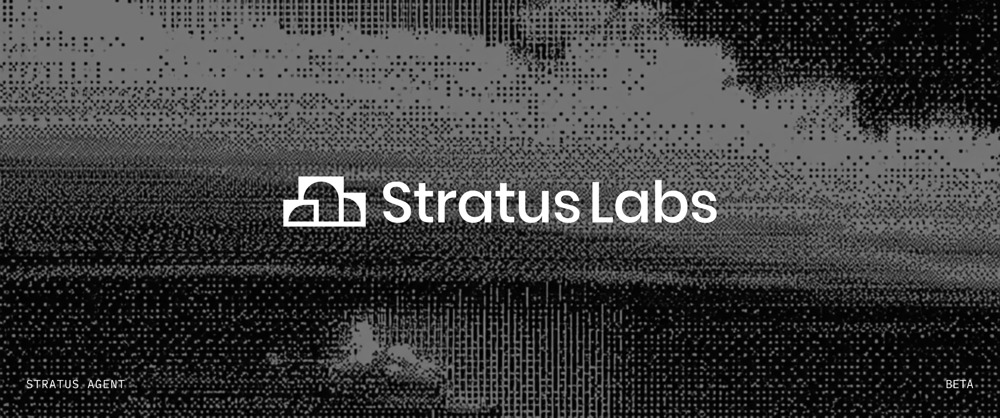

# Stratus Agent

**Always-on agents that get smarter over time.**

[](https://www.npmjs.com/package/@stratusagent/cli)
[](docs/start/installation.md)
[](LICENSE)

Stratus is a small, readable runtime for a team of persistent AI agents.
Each agent has its own name, memory, tools, and Slack presence, and it
remembers tomorrow what you told it today. The core stays lean. Everything
else is a plugin you add when you want it.

> **Pre-1.0:** expect breaking changes between minor versions. Check
> [Updating](docs/guides/updating.md) before you upgrade.

## Quickstart

```bash
npm install -g @stratusagent/cli
stratus setup     # sign in, create an agent, pick tools, connect Slack
stratus chat      # talk; the conversation persists
```

Needs Node 22.16+ or 24+ ([Installation](docs/start/installation.md), which also
covers `EACCES` on Linux). No key yet?
[Quickstart](docs/start/quickstart.md) has an offline demo.

## Why Stratus

- **Lightweight by default.** One package and a tiny TypeScript kernel.
  Installing a tool runs nothing until your config enables it and an
  agent's soul allows it. [Plugins](docs/concepts/plugins.md)
- **Extensible.** Providers, channels, memory stores, tools, and executors
  are all plugins. Mount any MCP server, or install skills from any GitHub
  repo. [Extending](docs/guides/extending.md) ·
  [MCP](docs/guides/mcp.md) · [Skills](docs/guides/skills.md)
- **Local or cloud.** The same `stratus serve` runs on your laptop as a
  background service, or on a server in Docker or under systemd.
  [Always on](docs/guides/always-on.md) ·
  [Deployment](docs/guides/deployment.md)
- **Multiplayer and multi-tenant.** A team of agents works alongside a
  team of people in Slack: each agent is its own app, follows its threads,
  delegates to the others, and asks a person in Slack when approval is needed.
  One host can serve many teams, each kept to its own agents and data.
  [Slack](docs/guides/slack.md) · [Agents](docs/concepts/agents.md)
- **Opinionated defaults.** A sandboxed shell, a human asked before
  dangerous actions, memory that belongs to the agent, and schedules a
  human approves once. Tighten it to ask before every gated tool, or loosen
  it, in config. [Security](docs/concepts/security.md) ·
  [Approvals](docs/guides/approvals.md)
- **A growing plugin ecosystem.** Built-in packages for Claude,
  ChatGPT/Codex, OpenAI-compatible APIs, Slack, files, shell, web, and a
  browser. [stratuslabs/plugins](https://github.com/stratuslabs/plugins)
  adds nightly encrypted backups, parallel sub-agents, a macOS command
  sandbox, and native UI screens via A2UI, with more on the way.
  [Tools](docs/guides/tools.md)

## An agent is a file

Each agent's identity lives in a **soul file**: frontmatter for the
structured parts, prose for the personality.

```markdown
---
name: Blair
provider: anthropic
model: claude-opus-5-5
tools: [fs.read, fs.search, web.fetch, memory.*]
skills: [code-review]
listens: judge
---

You are a sharp, warm generalist assistant. Answer first, explain second...
```

Skip the name and Stratus picks one, with a matching avatar:

```bash
stratus agent new
# Say hello to Freya.
```

More in [Agents](docs/concepts/agents.md).

## Documentation

| I want to… | Read |
| --- | --- |
| Install and set up | [Installation](docs/start/installation.md) · [Setup](docs/start/setup.md) · [Quickstart](docs/start/quickstart.md) |
| Put agents in Slack | [Slack](docs/guides/slack.md) |
| Give agents tools, safely | [Tools](docs/guides/tools.md) · [Shell](docs/guides/shell.md) · [Approvals](docs/guides/approvals.md) |
| Run it always on, or on a server | [Always on](docs/guides/always-on.md) · [Deployment](docs/guides/deployment.md) · [Updating](docs/guides/updating.md) |
| Fix a surprise | [Troubleshooting](docs/guides/troubleshooting.md) |
| Look up a command or config key | [CLI](docs/reference/cli.md) · [Configuration](docs/reference/config.md) |
| Build against it | [Control API](packages/control-api/README.md) · [Architecture](docs/architecture/stratus-v2.md) |

Everything else is in [`docs/`](docs/README.md).

## Known limitations

What doesn't work yet, or works differently than you might assume, is in
[Known limitations](docs/concepts/limitations.md).

## From source

```bash
# Node 25+ no longer ships Corepack: npm install -g corepack
corepack enable && corepack prepare pnpm@10.18.3 --activate
git clone https://github.com/stratuslabs/agent.git && cd agent
pnpm install --frozen-lockfile
pnpm build && pnpm typecheck && pnpm test    # what CI runs
node packages/cli/dist/bin.js setup          # the CLI from the checkout
```

Read [`CONTRIBUTING.md`](CONTRIBUTING.md) before opening a PR. Report
security problems privately, as [`SECURITY.md`](SECURITY.md) describes.

## License

[MIT](LICENSE)
